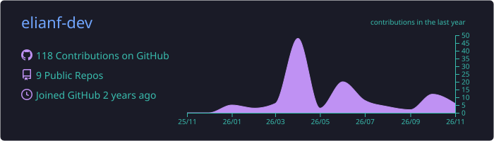
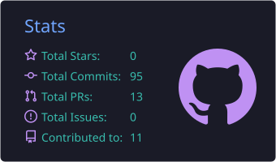
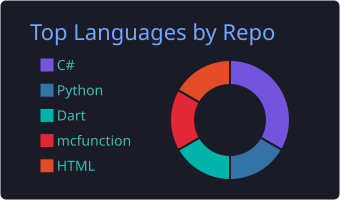

<div align="center">


<a href="https://github.com/elianf-dev"></a>


</div>

---

### 🧑‍💻 About me

```ts
const eli = {
  location: "Chicago, IL",
  role: "Freelance developer",
  builds: ["custom business websites", "mobile apps", "games & mods"],
  currentlyShipping: "VitaMind 🌿",
  askMeAbout: ["web dev", "Flutter", "Android", "C#"],
};
```

### 🛠️ Toolbox

<p align="center">
  
</p>

### 🚀 Featured projects

<table>
<tr>
<td width="50%" valign="top">

#### 🌿 [VitaMind](https://github.com/elianf-dev/VitaMind)
A safe, source-supported wellness companion app.
<br/> 

</td>
<td width="50%" valign="top">

#### 🚽 [Pee Tracker](https://github.com/elianf-dev/pee-tracker)
A *competitive* bathroom-trip tracker for you and your friends. Yes, really.
<br/>  

</td>
</tr>
<tr>
<td valign="top">

#### 🔥 [Avatar Bending RPG](https://github.com/elianf-dev/avatar-bending-rpg)
Element-bending RPG mechanics built as a Minecraft datapack.
<br/>

</td>
<td valign="top">

#### 🗃️ [The Collector's Keep](https://github.com/elianf-dev/TheCollectorsKeep_Capstone)
Capstone app for managing a collection, built in C# with a layered architecture.
<br/>

</td>
</tr>
<tr>
<td valign="top">

#### 💼 [Portfolio](https://github.com/elianf-dev/portfolio)
My personal site — the front door to everything I build.
<br/>

</td>
<td valign="top">

#### 🌐 Client websites
Custom one-page sites for Chicago-area small businesses (restaurants, towing, retail). [See an example →](https://github.com/elianf-dev/irazu_site)
<br/> 

</td>
</tr>
</table>

<details>
<summary>🎲 <b>Click for a random fact about me</b></summary>
<br/>
I once built an app whose entire purpose is ranking my friends by bathroom trips. It has a leaderboard. 🏆
</details>

### 📊 Stats

<div align="center">
  
  <br/>
  
  
  <br/>
  
</div>

### 🐍 Contribution snake

<p align="center">
  
</p>

---

<div align="center">

**Need a website for your business?** Let's talk → [elianfigueroa67@gmail.com](mailto:elianfigueroa67@gmail.com)

</div>
